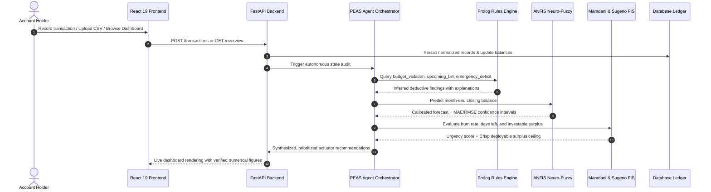

# FinSense — Project Architecture & Unified Workflow Map

## Executive Overview
**FinSense** is an Autonomous AI-Powered Personal Finance Management System developed as an academic capstone mini project demonstrating ten AI and intelligent-system techniques through one integrated real-world fintech product.

The application contains zero "Experiment 1", "Exp 02", or academic showcase labels. Every AI subsystem serves a genuine, professional financial management capability across 12 product views:
1. Overview Dashboard
2. Transactions & Multi-Account Ledger
3. Budget Management & Adherence
4. Financial Goals & Milestones
5. Cash Flow Forecasting
6. Spending Insights & Machine Learning
7. Savings Planner & Optimization
8. Bills, Subscriptions & Decision Simulator
9. Investment Readiness Assessment
10. AI Financial Copilot
11. Reports & Statement Exports
12. Settings & System Diagnostics

---

## System Architecture Diagram

```mermaid
graph TD
    subgraph Client Layer [Frontend - React 19 + TypeScript + Vite]
        UI[User Interface & Dashboard]
        Router[12 Product Capability Views]
        Charts[Recharts Financial Visualizations]
        APIClient[Typed Axios/Fetch API Client]
    end

    subgraph API & Orchestration Layer [Backend - FastAPI]
        AuthRouter[/api/v1/auth]
        FinanceRouter[/api/v1/transactions, /budgets, /goals, /bills]
        IntelligenceRouter[/api/v1/savings-planner, /cashflow, /insights, /investment]
        CopilotRouter[/api/v1/copilot]
        PEASAgent[PEAS Agent Orchestrator]
    end

    subgraph Intelligent Systems & Reasoning Layer [10 AI Engines]
        PrologEngine[2. First-Order Logic Prolog Engine]
        DependencyGraph[3. BFS/DFS Financial Dependency Graph]
        AStarSearch[4. A* Goal Budget Space Search]
        MinimaxSim[5. Minimax Game-Tree Bill Simulator]
        FuzzyAlert[6. Fuzzy Spending Alert Controller]
        InvestmentFIS[7. Dual Mamdani vs Sugeno FIS]
        ANFISModel[8. 5-Layer TSK Neuro-Fuzzy Forecaster]
        NeuralAnalytics[9. Supervised Perceptron & Competitive SOM]
        CopilotSLM[10. Grounded Tool-Routed SLM Copilot]
    end

    subgraph Data & Storage Layer
        DB[(SQLAlchemy SQLite / PostgreSQL)]
        SeedData[Indian INR Calibrated Financial Dataset]
        ReportLab[ReportLab PDF Engine]
    end

    UI --> APIClient
    APIClient --> AuthRouter
    APIClient --> FinanceRouter
    APIClient --> IntelligenceRouter
    APIClient --> CopilotRouter

    FinanceRouter --> DB
    IntelligenceRouter --> PEASAgent

    PEASAgent --> PrologEngine
    PEASAgent --> DependencyGraph
    PEASAgent --> AStarSearch
    PEASAgent --> MinimaxSim
    PEASAgent --> FuzzyAlert
    PEASAgent --> InvestmentFIS
    PEASAgent --> ANFISModel
    PEASAgent --> NeuralAnalytics
    CopilotRouter --> CopilotSLM
    CopilotSLM --> FinanceRouter

    DB --> SeedData
    IntelligenceRouter --> DB
```

---

## Unified Financial Intelligence Workflow



---

## Complete Database Schema Entities
- `User`: Profile, hashed password, stated monthly income (INR), base currency.
- `Account`: Bank accounts (checking, savings, credit, investment) with live balances.
- `Category`: Categories with essential flags and flexibility scores (0.0 to 1.0).
- `Transaction`: Amount, date, merchant, category, type, anomaly flag & score, user feedback flag.
- `Budget`: Monthly caps, category allocations, period strings (`YYYY-MM`).
- `Goal`: Savings target, current saved amount, deadline date, priority.
- `RecurringBill`: Subscriptions, amounts, due days, providers, negotiable indicators.
- `ForecastRecord`: ANFIS predictions, baseline comparison, confidence intervals, error metrics.
- `AssessmentRecord`: Fuzzy controller urgency score, Mamdani readiness score, Sugeno investable surplus.
- `OptimizationScenario`: A* reduction steps, unlocked savings, path cost, feasibility notes.
- `BillSimulation`: Minimax game tree simulations, best strategy, estimated annual savings.
- `Notification`: Alerts, warnings, recommendations, source AI technique.
- `Conversation` & `Message`: Chat history with tool execution metadata and numerical citations.
- `ModelRun`: Historical training and evaluation metrics.
