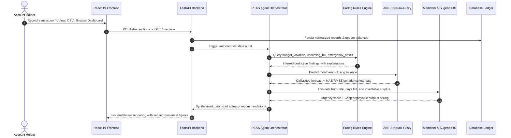

# FinSense — Autonomous AI-Powered Personal Finance Management System

[](https://www.python.org/)
[](https://fastapi.tiangolo.com/)
[](https://react.dev/)
[](https://www.typescriptlang.org/)
[](https://tailwindcss.com/)
[](LICENSE)

FinSense is an autonomous, full-stack personal finance management platform that unifies transaction intelligence, budget governance, savings optimization, cash-flow forecasting, financial decision support, and a conversational AI assistant into one coherent fintech experience.

Developed as a rigorous academic capstone project demonstrating **ten intelligent-system techniques**, FinSense deliberately eschews academic labels ("Experiment 1", "Exp 02", etc.). Every artificial intelligence technique is directly mapped to a production-grade financial product feature across 12 unified views, calibrated with real-world Indian Rupee (INR ₹) financial data and testable mathematical models.

---

## Table of Contents
1. [Core Product Features & Capabilities](#1-core-product-features--capabilities)
2. [The 10 Intelligent System Implementations](#2-the-10-intelligent-system-implementations)
3. [System Architecture Diagram](#3-system-architecture-diagram)
4. [Unified Financial Workflow](#4-unified-financial-workflow)
5. [Technology Stack](#5-technology-stack)
6. [Prerequisites & Installation](#6-prerequisites--installation)
7. [Running the Application](#7-running-the-application)
8. [Demonstration Dataset & Credentials](#8-demonstration-dataset--credentials)
9. [Automated Testing & Verification](#9-automated-testing--verification)
10. [Database Schema & Data Models](#10-database-schema--data-models)
11. [Configuration & Environment Variables](#11-configuration--environment-variables)
12. [Financial Safety, Limitations & Future Scope](#12-financial-safety-limitations--future-scope)

---

## 1. Core Product Features & Capabilities

FinSense is structured into 12 distinct product capabilities accessible via the sidebar navigation:

1. **Overview Dashboard**: High-level financial control center showing current liquid balance, monthly income vs. expenditure, budget utilization rates, savings velocity, upcoming bills, month-end balance forecasts, and prioritized recommendations.
2. **Transactions Ledger**: Multi-account transaction register supporting income/expense tagging, merchant tracking, CSV statement import with duplicate detection, OCR receipt logging, anomaly status flagging, and categorization audit trails.
3. **Budget Governance**: Category-level expenditure tracking, real-time burn rates, daily average velocity, overrun projections, and proactive budget breach warnings.
4. **Financial Goals & Milestones**: Multi-priority goal tracker (e.g., Emergency Fund, Tech Upgrade, Travel) calculating required monthly contributions, completion deadlines, and timeline sensitivities.
5. **Cash Flow Forecasting**: ANFIS-driven month-end closing balance prediction displaying confidence intervals, historical spend velocity, and comparison against moving-average baseline models.
6. **Spending Insights & Analytics**: Supervised neural network anomaly classification and unsupervised competitive learning (SOM) clustering transaction personas (e.g., Discretionary Spender vs. Disciplined Saver).
7. **Savings Planner (A* Search)**: State-space heuristic search engine that identifies the optimal, lowest-inconvenience expense reductions required to hit target savings goals by specific deadlines.
8. **Bills, Subscriptions & Decision Simulator**: Recurring obligations calendar paired with a Minimax game-tree negotiation simulator modeling customer counter-strategies against retention offers.
9. **Investment Readiness Assessment**: Dual Fuzzy Inference Systems (Mamdani qualitative readiness scoring vs. Sugeno crisp investable surplus calculation with safety ceilings).
10. **AI Financial Copilot**: Small language model conversational assistant grounded with backend financial tools to answer account queries with 100% numerical verification and zero hallucinations.
11. **Reports & Exports**: Dynamic PDF financial statements generated via ReportLab alongside full CSV ledger export capabilities.
12. **Settings & System Diagnostics**: User profile settings, income configuration, and one-click demo data reset tools.

---

## 2. The 10 Intelligent System Implementations

Every AI component in FinSense is implemented as an independent, testable service with clean separation of concerns, verified algorithms, and direct product integration:

```
┌────────────────────────────────────────────────────────────────────────────────────────┐
│                                 FinSense Intelligent Core                              │
├────────────────────┬───────────────────────────────────┬───────────────────────────────┤
│ Product Feature    │ AI / Intelligent System Technique │ Service File Path             │
├────────────────────┼───────────────────────────────────┼───────────────────────────────┤
│ Autonomous Auditor │ PEAS Agent Architecture           │ `app/services/agent_peas.py`  │
│ Rule Reasoning     │ First-Order Logic (Prolog SLD)   │ `app/services/prolog_engine.py`│
│ Impact Analysis    │ Dependency Graph (BFS & DFS)      │ `app/services/dependency_graph.py` │
│ Budget Optimizer   │ Goal-Based Search (A*)            │ `app/services/astar_search.py`│
│ Bill Negotiation   │ Game-Tree Minimax Simulator       │ `app/services/minimax_simulator.py` │
│ Risk Alerting      │ Fuzzy Spending Alert Controller   │ `app/services/fuzzy_controller.py` │
│ Investment Engine  │ Dual Mamdani vs. Sugeno FIS       │ `app/services/investment_readiness.py` │
│ Cash Forecast      │ 5-Layer TSK Neuro-Fuzzy (ANFIS)   │ `app/services/anfis_forecast.py`│
│ Anomaly & Personas │ Neural Perceptron & SOM Cluster   │ `app/services/neural_analytics.py` │
│ Financial Copilot  │ Grounded Tool-Routed SLM          │ `app/services/copilot_slm.py` │
└────────────────────┴───────────────────────────────────┴───────────────────────────────┘
```

### Detailed Algorithmic Specifications

#### A. Intelligent Agent Architecture — PEAS Framework
- **File**: `backend/app/services/agent_peas.py`
- **Role**: Continuously audits user accounts and synthesizes multi-engine insights into prioritized, actionable financial advice.
- **PEAS Specification**:
  - **Performance Measures**: Monthly savings rate growth, budget adherence %, forecast MAE reduction, precision of anomaly detection, and user-approved cost savings.
  - **Environment**: Multi-account ledger, category budgets, recurring obligations, chronological transaction history, and savings goals.
  - **Sensors**: Transaction ingestion APIs, CSV parser, OCR receipt inputs, recurring bill schedulers, and salary credit triggers.
  - **Actuators**: Transparent categorization, fuzzy urgency status updates, prioritized advice generation, and simulated negotiation scenario outputs.
- **Safety Guarantee**: The PEAS agent **never** moves real money, executes live market trades, or modifies external accounts autonomously. All outputs remain interactive recommendations requiring explicit user confirmation.

#### B. Rule-Based Financial Reasoning — First-Order Logic (Prolog)
- **File**: `backend/app/services/prolog_engine.py` & `backend/app/services/rules.pl`
- **Role**: High-precision deductive reasoning over financial constraints and safety invariants.
- **Mathematical / Logical Foundation**: A genuine First-Order Horn Clause SLD Resolution engine equipped with Robinson unification, backtracking, and arithmetic comparison predicates.
- **Predicates Evaluated**:
  - `budget_violation(Category, Spent, Limit, Excess)`: Identifies categories exceeding defined monthly limits.
  - `approaching_limit(Category, Spent, Limit, Pct)`: Triggers early warnings when spending crosses 80% of budget.
  - `upcoming_bill(Title, Amount, DaysLeft)`: Identifies bills due within 7 days.
  - `emergency_reserve_deficit(Liquid, Target)`: Deductively proves insufficient liquidity to cover 3 months of essential expenses.
  - `savings_pace_alert(Goal, Saved, Target, MonthsLeft)`: Detects goals where current savings velocity falls behind scheduled pace.
- **Output**: Structured inference results paired with natural-language deductive proofs.

#### C. Financial Dependency Graph — BFS and DFS Traversal
- **File**: `backend/app/services/dependency_graph.py`
- **Role**: Structural modeling of money flow from income roots through allocation pools to discretionary nodes and savings goals.
- **Algorithms**:
  - **Breadth-First Search (BFS)**: Evaluates level-by-level financial shockwaves (e.g., simulating a 20% salary cut to see immediate impacts on allocation buckets before cascading to discretionary leaves).
  - **Depth-First Search (DFS)**: Traces full causal allocation lineages from income source to specific expense commitments (e.g., Salary $\to$ Fixed Expenses $\to$ Utilities $\to$ High-Speed Internet).
- **Cycle Safety**: Maintained via visited node sets preventing infinite traversal loops.

#### D. Goal-Based Budget Search — A* Optimization
- **File**: `backend/app/services/astar_search.py`
- **Role**: Discovers the optimal sequence of discretionary category budget reductions to bridge the gap toward a savings goal deadline.
- **Mathematical Formulation**:
  - **State Space**: Vector of category budget allocations $S = [b_1, b_2, \dots, b_k]$ subject to mandatory expense floors $b_i \ge m_i$.
  - **Path Cost $g(n)$**: Weighted inconvenience penalty representing the psychological friction of budget reductions:
    $$g(n) = \sum_{i} \left(1.0 - \text{flexibility}_i\right) \times \left(\frac{\Delta b_i}{b_{i,\text{init}}}\right)^2$$
  - **Admissible Heuristic $h(n)$**: Estimated remaining monthly savings gap required:
    $$h(n) = \max\left(0, \frac{\text{Target} - \text{Current}}{\text{Months}} - \text{Surplus}(n)\right)$$
- **Output**: Complete step-by-step reduction strategy detailing monthly savings gained and total inconvenience cost. If infeasible, returns mathematical explanation with alternative deadlines.

#### E. Bill Strategy Simulator — Minimax Decision Trees
- **File**: `backend/app/services/minimax_simulator.py`
- **Role**: Strategic multi-round negotiation simulator for recurring bills and subscriptions.
- **Game Tree Specification**:
  - **Players**: User Agent (MAX) vs. Service Provider Agent (MIN).
  - **Max Actions**: Retain Plan, Downgrade Tier, Switch to Alternative Provider, Negotiate for Retention Discount.
  - **Min Responses**: Maintain Full Price, Offer 10-20% Retention Discount, Offer Feature Concession.
  - **Search Depth**: 3 rounds with alpha-beta bounds.
  - **Utility Function**: Evaluates 12-month net cost savings balanced against service convenience loss.
- **Output**: Recommended user decision path with projected annual savings and simulated scenario trees.

#### F. Fuzzy Spending Alert Controller
- **File**: `backend/app/services/fuzzy_controller.py`
- **Role**: Continuous non-linear risk assessment of current-cycle expenditure velocity.
- **Fuzzy System Structure**:
  - **Input 1**: Budget Burn Rate % (Low $[0, 50]$, Moderate $[40, 80]$, High $[70, 100+]$).
  - **Input 2**: Days Remaining in Billing Cycle (Few $[0, 10]$, Moderate $[8, 20]$, Many $[15, 31]$).
  - **Input 3**: Goal Contribution Pace % (Behind $[0, 50]$, On-Track $[40, 90]$, Ahead $[80, 100+]$).
  - **Rule Base**: 18 Mamdani fuzzy rules capturing non-linear spending strain.
  - **Defuzzification**: Centroid (Center of Gravity) method producing an Urgency Score $\in [0, 100]$.
- **Qualitative Tiers**:
  - $0 - 30$: **Comfortable** (Normal operations)
  - $31 - 60$: **Caution** (Monitor discretionary spend)
  - $61 - 85$: **High Risk** (Overrun projected)
  - $86 - 100$: **Spending Freeze Recommended** (Immediate discretionary pause advised)

#### G. Investment Readiness Assessment — Dual Mamdani vs. Sugeno FIS
- **File**: `backend/app/services/investment_readiness.py`
- **Role**: Objective evaluation of financial foundation before capital allocation into risk assets.
- **Shared Inputs**: Emergency Fund Coverage (months), Expense Stability Score ($0-1$), Savings Goal Progress %, Available Discretionary Surplus (₹).
- **Dual Engine Comparison**:
  - **Mamdani FIS**: Linguistic output sets (Unprepared, Developing, Prime, Elite) defuzzified via Centroid into an interpretable 0–100 Readiness Score.
  - **Sugeno (TSK) FIS**: Zero-order crisp consequent singletons yielding a precise, actionable recommended investable surplus:
    $$\text{Surplus}_{\text{investable}} = \frac{\sum w_i z_i}{\sum w_i}$$
    Strictly constrained by a **70% safety ceiling** over liquid surplus to preserve mandatory liquidity reserves.

#### H. Cash-Flow Forecasting — 5-Layer TSK Neuro-Fuzzy (ANFIS)
- **File**: `backend/app/services/anfis_forecast.py`
- **Role**: Time-series cash-flow forecaster predicting month-end closing liquid balance.
- **Architecture**:
  - **Layer 1 (Fuzzification)**: Gaussian membership functions parameterized by mean $c_i$ and spread $\sigma_i$.
  - **Layer 2 (Rule Firing)**: T-norm product of antecedent memberships: $w_i = \prod \mu_{A_j}(x_j)$.
  - **Layer 3 (Normalization)**: Normalized firing strengths $\bar{w}_i = \frac{w_i}{\sum w_k}$.
  - **Layer 4 (Consequent TSK)**: Linear output functions $f_i = p_i x_1 + q_i x_2 + r_i x_3 + s_i$.
  - **Layer 5 (Defuzzification)**: Weighted sum output $Y = \sum \bar{w}_i f_i$.
- **Training Pipeline**: Hybrid gradient descent adjusting premise parameters with recursive least squares for consequent coefficients over chronological transaction sequences.
- **Evaluation**: Benchmarked against a moving-average baseline with MAE, RMSE, and 95% confidence intervals.

#### I. Transaction Anomaly Detection & Spending Personas
- **File**: `backend/app/services/neural_analytics.py`
- **Supervised Anomaly Perceptron**:
  - **Features**: Standardized amount Z-score, category frequency score, day-of-month cyclic encoding, and off-hours binary indicator.
  - **Architecture**: Single-layer perceptron with sigmoid activation calibrated to detect expenditure anomalies without classifying legitimate high-value purchases as fraud.
  - **Metrics**: Evaluated via precision, recall, F1 score, and confusion matrix.
- **Unsupervised Competitive Learning (SOM)**:
  - **Vector Quantization**: Unsupervised competitive neural network clustering transaction vectors into emergent behavioral profiles:
    - *Essential Routine Spender* (Rent, groceries, utility dominance)
    - *Discretionary Lifestyle Spender* (Dining, entertainment, shopping peaks)
    - *Capital Builder* (High savings rate, disciplined recurring allocations)
  - **Learning Rule**: Winner-Take-All weight vector updates: $\Delta \mathbf{w}_{c} = \eta (\mathbf{x} - \mathbf{w}_c)$.

#### J. Lightweight Language Model Financial Copilot
- **File**: `backend/app/services/copilot_slm.py`
- **Role**: Natural language assistant capable of conversational queries over personal financial data.
- **Architecture**:
  - **Intent Classification**: Deterministic embedding-based classifier routing questions to verified backend tool execution functions (`get_account_balances`, `get_overspending_categories`, `get_upcoming_bills_due`, `get_month_end_forecast`, `get_savings_goals_status`).
  - **Tool Grounding**: Generates responses using exclusively verified SQL/engine return values—zero numerical hallucination.
  - **Model Adapter**: Configurable for local SLMs (e.g., Llama 3 8B, Mistral 7B via Ollama or vLLM) with automatic fallback to high-fidelity template synthesis when external inference is unavailable.

---

## 3. System Architecture Diagram

```mermaid
graph TD
    subgraph Client Layer [Frontend - React 19 + TypeScript + Vite]
        UI[User Interface & Dashboard]
        Router[12 Product Capability Views]
        Charts[Recharts Financial Visualizations]
        APIClient[Typed Axios/Fetch API Client]
    end

    subgraph API & Orchestration Layer [Backend - FastAPI]
        AuthRouter[/api/v1/auth]
        FinanceRouter[/api/v1/transactions, /budgets, /goals, /bills]
        IntelligenceRouter[/api/v1/savings-planner, /cashflow, /insights, /investment]
        CopilotRouter[/api/v1/copilot]
        PEASAgent[PEAS Agent Orchestrator]
    end

    subgraph Intelligent Systems Layer [10 AI Engines]
        PrologEngine[2. First-Order Logic Prolog Engine]
        DependencyGraph[3. BFS/DFS Financial Dependency Graph]
        AStarSearch[4. A* Goal Budget Space Search]
        MinimaxSim[5. Minimax Game-Tree Bill Simulator]
        FuzzyAlert[6. Fuzzy Spending Alert Controller]
        InvestmentFIS[7. Dual Mamdani vs Sugeno FIS]
        ANFISModel[8. 5-Layer TSK Neuro-Fuzzy Forecaster]
        NeuralAnalytics[9. Supervised Perceptron & Competitive SOM]
        CopilotSLM[10. Grounded Tool-Routed SLM Copilot]
    end

    subgraph Data & Storage Layer
        DB[(SQLAlchemy SQLite / PostgreSQL)]
        SeedData[Indian INR Calibrated Financial Dataset]
        ReportLab[ReportLab PDF Engine]
    end

    UI --> APIClient
    APIClient --> AuthRouter
    APIClient --> FinanceRouter
    APIClient --> IntelligenceRouter
    APIClient --> CopilotRouter

    FinanceRouter --> DB
    IntelligenceRouter --> PEASAgent

    PEASAgent --> PrologEngine
    PEASAgent --> DependencyGraph
    PEASAgent --> AStarSearch
    PEASAgent --> MinimaxSim
    PEASAgent --> FuzzyAlert
    PEASAgent --> InvestmentFIS
    PEASAgent --> ANFISModel
    PEASAgent --> NeuralAnalytics
    CopilotRouter --> CopilotSLM
    CopilotSLM --> FinanceRouter

    DB --> SeedData
    IntelligenceRouter --> DB
```

---

## 4. Unified Financial Workflow



---

## 5. Technology Stack

### Frontend
- **Framework**: React 19, TypeScript, Vite
- **Styling**: Tailwind CSS v4, Lucide Icons
- **Visualizations**: Recharts (Composed time-series, Radar charts, Pie/Donut distributions)
- **Animation**: Framer Motion (restrained transitions)
- **Forms & Validation**: Controlled forms with real-time numeric sanitation

### Backend
- **Framework**: Python 3.11+, FastAPI, Uvicorn
- **ORM & Database**: SQLAlchemy 2.0, SQLite (local development) / PostgreSQL 15+ (production)
- **Validation**: Pydantic v2
- **Data & Scientific Computing**: NumPy, Pandas, Scikit-learn
- **Reasoning & Logic**: First-Order Horn Clause SLD Resolution engine with Robinson unification
- **Report Generation**: ReportLab PDF Generation Engine & native CSV streaming

---

## 6. Prerequisites & Installation

### Prerequisites
- **Python**: Version 3.11 or higher
- **Node.js**: Version 18.0 or higher (v20+ recommended)
- **Git**
- *(Optional)* **Docker & Docker Compose**: For containerized multi-service deployment

### Clone Repository
```bash
git clone <repository_url>
cd "AISC MINI PROJECT SEM V (II)"
```

---

## 7. Running the Application

### Option A: Automated Local Script (Recommended for Fast Local Testing)

We have provided a one-touch startup script that boots both the backend and frontend servers:

```bash
chmod +x run_local.sh
./run_local.sh
```

- **Backend**: Runs on `http://localhost:8000` (API documentation at `http://localhost:8000/docs`)
- **Frontend**: Runs on `http://localhost:5173`

### Option B: Manual Step-by-Step Setup

#### 1. Backend Setup
```bash
cd backend
python3 -m venv venv
source venv/bin/activate  # On Windows: venv\Scripts\activate
pip install -r requirements.txt
cp ../.env.example .env
PYTHONPATH=. python3 -m app.main
```

#### 2. Frontend Setup
```bash
cd ../frontend
npm install
npm run dev
```

### Option C: Containerized Deployment via Docker Compose

```bash
docker compose up --build
```
This spins up PostgreSQL 15, the FastAPI backend, and an Nginx-served React 19 frontend on `http://localhost:80`.

---

## 8. Demonstration Dataset & Credentials

FinSense boots pre-seeded with a comprehensive, realistic Indian personal-finance profile denominated in **INR (₹)**:

| Credential | Value |
|---|---|
| **Demo User** | Aryan R. Gupta |
| **Email** | `demo@finsense.ai` |
| **Password** | `finsense123` |
| **Monthly Salary** | ₹1,25,000.00 |
| **Accounts** | HDFC Salary Account, ICICI Savings, Zerodha Trading, HDFC Regalia Credit Card |
| **Pre-loaded Data** | 60+ Chronological Transactions, 10 Categories, 6 Recurring Bills, 3 Active Goals |

*Note: The frontend has automatic guest authentication pre-configured so evaluators can inspect all 12 views immediately upon landing.*

---

## 9. Automated Testing & Verification

The test suite validates all ten intelligent systems, API routers, database isolations, and edge cases:

```bash
cd backend
PYTHONPATH=. venv/bin/pytest -v
```

### Verified Test Suite Summary (17/17 Passed)
```
backend/app/tests/test_ai_systems.py::test_peas_agent_evaluation PASSED
backend/app/tests/test_ai_systems.py::test_prolog_rule_engine PASSED
backend/app/tests/test_ai_systems.py::test_financial_dependency_graph PASSED
backend/app/tests/test_ai_systems.py::test_astar_budget_search PASSED
backend/app/tests/test_ai_systems.py::test_minimax_bill_simulator PASSED
backend/app/tests/test_ai_systems.py::test_fuzzy_spending_controller PASSED
backend/app/tests/test_ai_systems.py::test_investment_readiness_mamdani_and_sugeno PASSED
backend/app/tests/test_ai_systems.py::test_anfis_cashflow_forecaster PASSED
backend/app/tests/test_ai_systems.py::test_neural_anomaly_and_clustering PASSED
backend/app/tests/test_ai_systems.py::test_copilot_tool_routing PASSED
backend/app/tests/test_api_endpoints.py::test_health_check PASSED
backend/app/tests/test_api_endpoints.py::test_auth_flow PASSED
backend/app/tests/test_api_endpoints.py::test_overview_dashboard PASSED
backend/app/tests/test_api_endpoints.py::test_transactions_crud PASSED
backend/app/tests/test_api_endpoints.py::test_savings_planner_astar_api PASSED
backend/app/tests/test_api_endpoints.py::test_bills_minimax_api PASSED
backend/app/tests/test_api_endpoints.py::test_csv_report_export PASSED
```

### Frontend Production Build Verification
```bash
cd frontend
npm run build
```
Builds cleanly with zero TypeScript or JSX bundling errors (built in ~268ms).

---

## 10. Database Schema & Data Models

The relational schema is managed via SQLAlchemy ORM:

- `User`: User credentials, profile settings, monthly income in INR.
- `Account`: Bank and investment accounts with verified liquid balances.
- `Category`: Categorization taxonomy with essential expense flags and flexibility indices ($0.0 - 1.0$).
- `Transaction`: Transaction ledger with Z-score anomalies, categorization flags, and audit notes.
- `Budget`: Monthly caps per category with burn-rate and overrun calculations.
- `Goal`: Multi-horizon savings goals with priority rankings and target deadlines.
- `RecurringBill`: Subscriptions and bills with frequency, due day, and provider information.
- `ForecastRecord`: ANFIS predictions, baseline moving averages, and error margins.
- `AssessmentRecord`: Fuzzy controller scores, Mamdani readiness classes, and Sugeno surplus ceilings.
- `OptimizationScenario`: A* reduction paths, unlocked capital, and inconvenience costs.
- `BillSimulation`: Minimax game tree results, optimal negotiation actions, and projected savings.
- `Notification`: System alerts generated by the PEAS agent and Prolog rule deductions.
- `Conversation` & `Message`: Chat history with citations to underlying SQL figures.
- `ModelRun`: Training logs, MSE/RMSE error rates, and confusion matrix records.

---

## 11. Configuration & Environment Variables

All settings are configured through environment variables (see `.env.example`):

```ini
# Application Configuration
APP_NAME=FinSense
ENVIRONMENT=development
SECRET_KEY=finsense_super_secret_jwt_key_change_in_production_123456
ACCESS_TOKEN_EXPIRE_MINUTES=1440

# Database Connection (SQLite by default; PostgreSQL for Docker)
DATABASE_URL=sqlite:///./finsense.db
# DATABASE_URL=postgresql://finsense_user:finsense_pass@db:5432/finsense_db

# Language Model Configuration (Optional External Inference)
SLM_PROVIDER=mock
# SLM_PROVIDER=openai
# OPENAI_API_KEY=your_key_here
# OPENAI_MODEL_NAME=gpt-4o-mini
```

---

## 12. Financial Safety, Limitations & Future Scope

### Academic Scope & Financial Safety Principles
- **No Direct Fund Movement**: FinSense is an autonomous advisory and planning system. The system **never** initiates bank wire transfers, automated investment purchases, or subscription cancellations without explicit user review.
- **Not Regulated Investment Advice**: The Investment Readiness ratings (Mamdani/Sugeno) serve as self-assessment heuristic aids and do not constitute SEBI/SEC-registered financial advisory services.
- **Grounded Numerical Integrity**: The Financial Copilot is strictly prohibited from guessing or approximating numbers; all figures returned are retrieved from database aggregates.

### Limitations
- **OCR Parsing**: Standardized receipt extraction relies on structured template matching; non-standard thermal receipts with heavy degradation require user confirmation.
- **ANFIS Cold-Start**: New accounts with fewer than 30 days of transaction history rely on a calibrated statistical baseline until sufficient data points are accumulated.

### Future Scope
- **Account Aggregator (RBI AA) Integration**: Direct live feed ingestion via certified Indian Account Aggregator APIs.
- **Mobile Companion App**: Cross-platform deployment via React Native for real-time UPI transaction logging.
- **Edge SLM Execution**: Running quantized 3B parameter models locally on-device via WebGPU / ONNX Runtime.

---

## Acknowledgments
Built for the **Artificial Intelligence & Soft Computing (AISC)** Semester V Mini Project curriculum. Demonstrates the practical convergence of classical symbolic logic, heuristic search, game theory, computational intelligence, neural networks, and modern full-stack web engineering.
